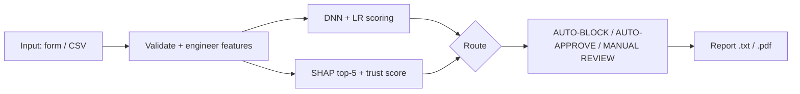
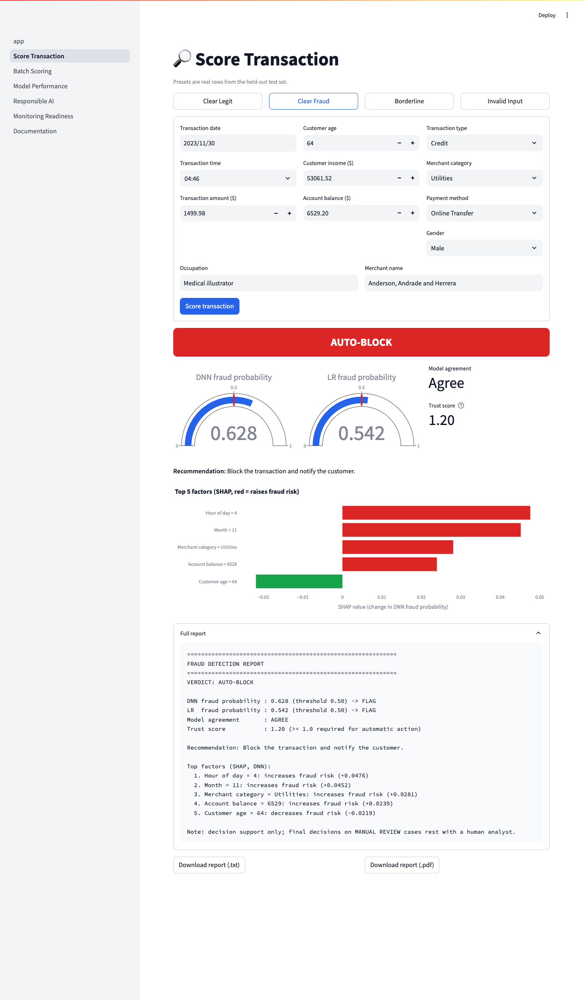
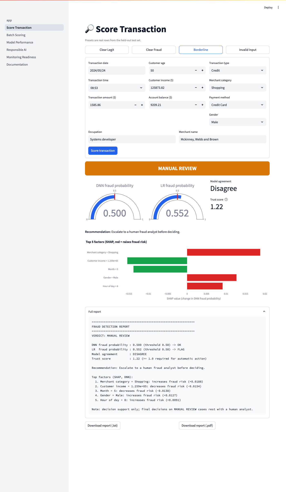
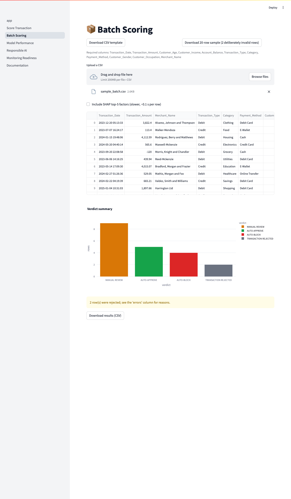
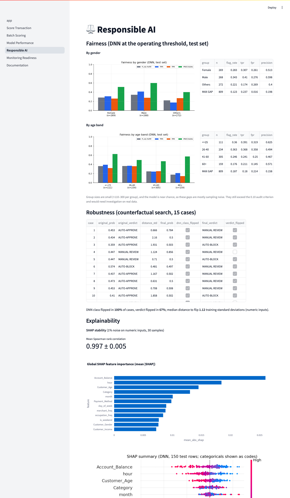
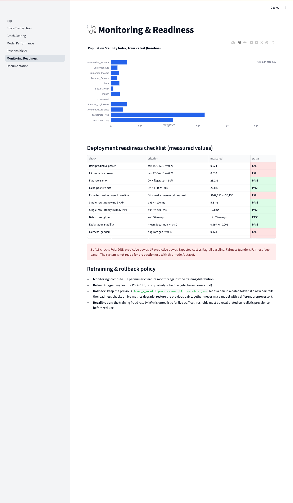

# Intelligent Fraud Detection System

A Streamlit decision-support system that scores banking transactions with a Keras DNN and logistic regression, explains them with SHAP, and routes uncertain cases to human review (Computational Intelligence Lab, Tasks 9 and 10).

> **Key finding.** Both models score close to chance (test ROC-AUC 0.524 DNN, 0.510 LR). A 5-fold gradient-boosting check on the raw data gives ≈0.51 as well. The dataset shows no learnable fraud signal (fraud rate is ≈49% in every category, and the account numbers and descriptions are unique per row, which suggests simulated data). The system demonstrates integration, explainability, testing and governance; it does **not** demonstrate real fraud-detection skill.

## Dataset
Kaggle banking-transactions fraud dataset (USA, 2023-2024). **5,389 rows**, **49.3% fraud** (2,657 fraud rows), 2023-01-21 to 2025-01-20, no missing values. Columns used: transaction date/time, amount, merchant, merchant category, transaction type, payment method, customer age, gender, occupation, income, account balance; label `Fraud_Flag`.

Source: [Kaggle link]

## Architecture


## Task 9 deliverables
| Deliverable | File path | Status |
|---|---|---|
| Integrated pipeline (`FraudPipeline`) | `src/pipeline.py` | Done |
| Streamlit app (6 pages + home) | `app.py`, `pages/` | Done |
| Models + preprocessor + metadata | `models/` | Done |
| Batch sample / template | `data/samples/sample_batch.csv` | Done |
| Dockerfile | `Dockerfile` | Done (not built in this environment) |
| One-command run | `scripts/run_all.sh` | Done |
| Deployment guide | `docs/DEPLOYMENT_GUIDE.md` | Done |

## Task 10 deliverables
| Deliverable | File path | Status |
|---|---|---|
| Metrics, thresholds | `reports/metrics.json` | Done |
| Figures (ROC, PR, confusion, cost, SHAP, fairness, drift) | `reports/figures/` | Done |
| Cost sweep | `reports/cost_threshold.csv` | Done |
| Latency | `reports/latency.json` | Done |
| SHAP stability | `reports/shap_stability.json` | Done |
| Fairness | `reports/fairness_gender.csv`, `reports/fairness_age.csv` | Done |
| Robustness | `reports/robustness.csv` | Done |
| Drift baseline | `reports/drift_baseline.csv` | Done |
| Readiness checklist | `reports/deployment_readiness.csv` | Done (5 checks FAIL) |
| Tests + report | `tests/`, `reports/testing_report.csv` | Done (13/13 pass) |
| SRS, SDD, user manual, RAI report, testing report, final report | `docs/` | Done |
| Final report PDF | `reports/Task9_10_Report.pdf` | Done |
| Notebook (executed) | `notebooks/01_eda_and_training.ipynb` | Done |

## Headline results (test set)
| Metric | DNN (threshold 0.50) | Logistic regression (0.50) |
|---|---|---|
| ROC-AUC | 0.524 | 0.510 |
| PR-AUC | 0.508 | 0.506 |
| F1 | 0.376 | 0.459 |
| Precision | 0.518 | 0.511 |
| Recall | 0.296 | 0.416 |
| Accuracy | 0.517 | 0.515 |
| Flag rate | 28.2% | 40.2% |
| Confusion matrix (TN/FP/FN/TP) | 300/110/281/118 | 251/159/233/166 |

Test set: 809 transactions (49.3% fraud). Source: `reports/metrics.json`.

Operating threshold: 0.50, see the threshold note in `docs/SDD.md`. Readiness: 5 of 15 checks FAIL (predictive power, cost vs flag-all, fairness gaps); do not use for real automatic decisions.

## Screenshots








## Quick start
```bash
python3.11 -m venv .venv && source .venv/bin/activate
pip install -r requirements.txt
# 1. place the dataset zip in data/raw/
python scripts/prepare_data.py data/raw/archive.zip   # 2. prepare data
python -m src.train                                   # 3. train
python -m src.evaluate                                # 4. evaluate
python -m pytest -q                                   #    tests
streamlit run app.py                                  # 5. run the app
```

### Everything in one command
```bash
bash scripts/run_all.sh
```

## Repository structure
```
fraud-detection-system/
├── README.md  requirements.txt  Dockerfile  pytest.ini  .gitignore
├── .streamlit/config.toml
├── app.py                      Home page
├── pages/                      Score, Batch, Performance, Responsible AI, Monitoring, Documentation
├── src/                        config, data, features, train, pipeline, evaluate, ui
├── scripts/                    prepare_data.py, run_all.sh, build_docs.py, build_report_pdf.py, screenshots.py
├── models/                     LR, DNN, preprocessor, metadata.json
├── data/                       raw/ (zip + csv), processed/, samples/sample_batch.csv
├── notebooks/                  01_eda_and_training.ipynb
├── reports/                    metrics.json, CSVs, figures/, Task9_10_Report.pdf
├── docs/                       SRS, SDD, USER_MANUAL, RESPONSIBLE_AI_REPORT, DEPLOYMENT_GUIDE, TESTING_REPORT, FINAL_REPORT, screenshots/
└── tests/
```

## Limitations
- No learnable fraud signal in this dataset (ROC-AUC ≈ 0.5); the system shows integration, not detection skill.
- ≈49% fraud rate is unrealistic for live banking traffic; thresholds must be recalibrated before real use.
- The data looks synthetic; fairness groups are small; SHAP explains the DNN only.
- Docker image and Hugging Face deployment were documented but not executed in the build environment.
- Raw data licence not verified: check the Kaggle licence before redistributing `data/raw/`.
