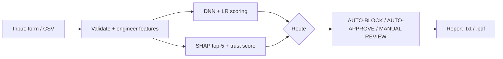
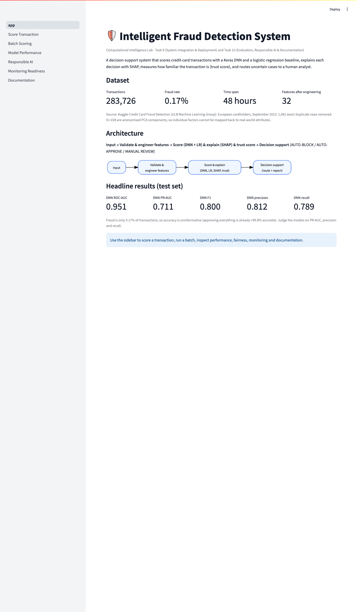
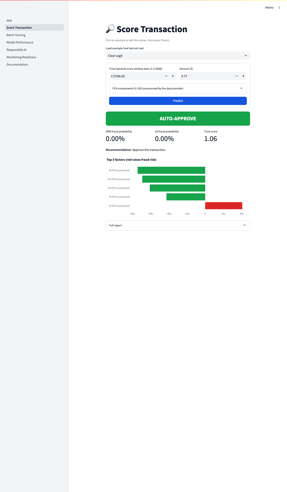
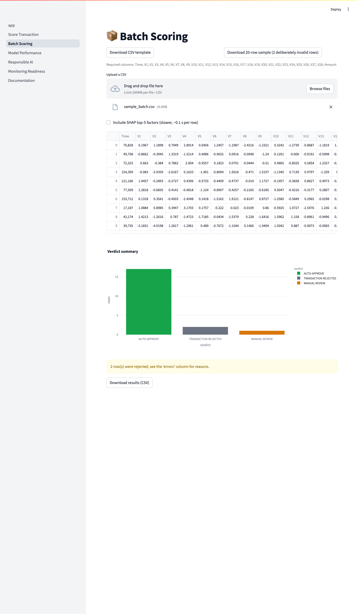
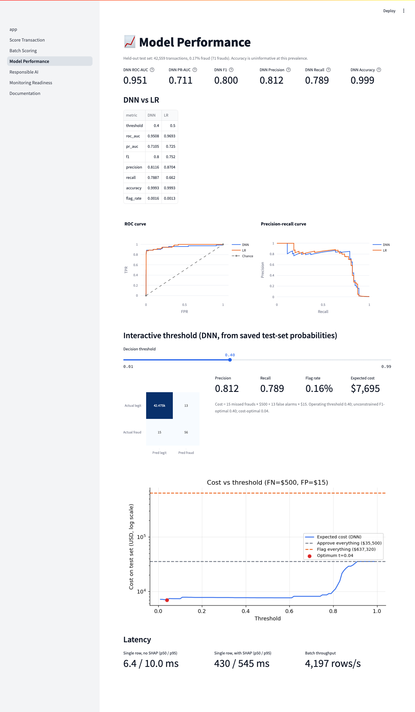
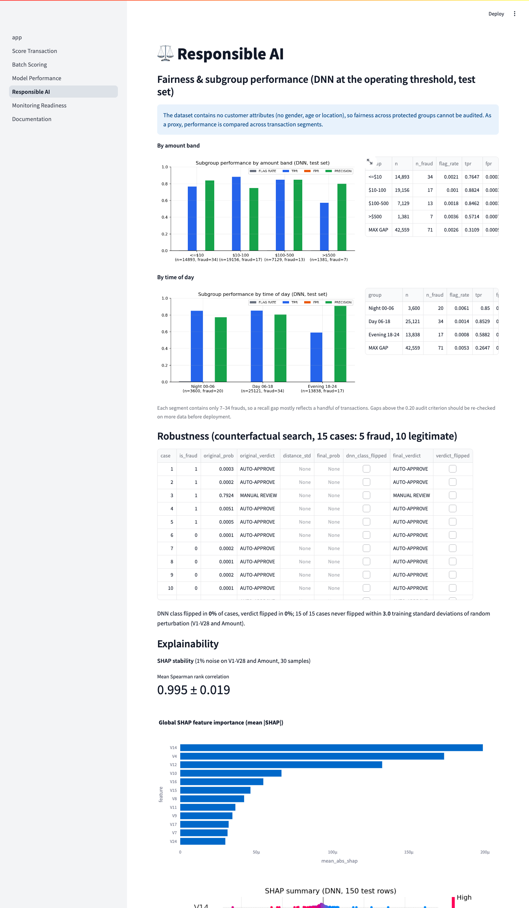

# Intelligent Fraud Detection System

A Streamlit decision-support system that scores credit-card transactions with a Keras DNN and logistic regression, explains them with SHAP, and routes uncertain cases to human review (Computational Intelligence Lab, Tasks 9 and 10).

> **Key finding.** Both models detect fraud well in ranking terms: test ROC-AUC 0.951 (DNN) and 0.969 (LR), PR-AUC 0.711 and 0.725 against a fraud base rate of only 0.17%. At its operating threshold the DNN catches 56 of 71 test frauds with 13 false alarms among 42,488 legitimate transactions. The simple logistic regression ranks slightly better than the DNN; the DNN's advantage is higher recall at the chosen threshold. Caveats: only 71 frauds in the test set (wide uncertainty), anonymised PCA features (explanations are not business-readable), two days of 2013 data, a random rather than temporal split, and no customer attributes for a fairness audit.

## Dataset
Kaggle **Credit Card Fraud Detection** dataset (ULB Machine Learning Group): transactions made by European cardholders over two days in September 2013. Raw file `creditcard.csv`: 284,807 rows; 1,081 exact duplicates removed, leaving **283,726 rows** with **473 frauds (0.167%)**, no missing values. Columns: `Time` (seconds since the first transaction, 48 h span), `V1`-`V28` (PCA components; the original features are confidential), `Amount` (max $25,691.16) and the label `Class` (1 = fraud). Source: https://www.kaggle.com/datasets/mlg-ulb/creditcardfraud (licence: Open Database License, ODbL).

Place `creditcard.csv` in `data/raw/` (it is git-ignored because of its 150 MB size).

## Architecture


## Task 9 deliverables
| Deliverable | File path | Status |
|---|---|---|
| Integrated pipeline (`FraudPipeline`) | `src/pipeline.py` | Done |
| Streamlit app (6 pages + home) | `app.py`, `pages/` | Done |
| Models + preprocessor + metadata | `models/` | Done |
| Batch sample / template | `data/samples/sample_batch.csv` | Done |
| Dockerfile | `Dockerfile` | Done (not built in this environment) |
| One-command run | `scripts/run_all.sh` | Done |
| Deployment guide | `docs/DEPLOYMENT_GUIDE.md` | Done |

## Task 10 deliverables
| Deliverable | File path | Status |
|---|---|---|
| Metrics, thresholds | `reports/metrics.json` | Done |
| Figures (ROC, PR, confusion, cost, SHAP, subgroups, drift) | `reports/figures/` | Done |
| Cost sweep | `reports/cost_threshold.csv` | Done |
| Latency | `reports/latency.json` | Done |
| SHAP stability | `reports/shap_stability.json` | Done |
| Subgroup / fairness analysis | `reports/fairness_amount.csv`, `reports/fairness_time.csv` | Done (no customer attributes in the data) |
| Robustness | `reports/robustness.csv` | Done |
| Drift baseline | `reports/drift_baseline.csv` | Done |
| Readiness checklist | `reports/deployment_readiness.csv` | Done (2 checks FAIL) |
| Tests + report | `tests/`, `reports/testing_report.csv` | Done (13/13 pass) |
| SRS, SDD, user manual, RAI report, testing report, final report | `docs/` | Done |
| Final report PDF | `reports/Task9_10_Report.pdf` | Done |
| Notebook (executed) | `notebooks/01_eda_and_training.ipynb` | Done |

## Headline results (test set)
| Metric | DNN (threshold 0.40) | Logistic regression (0.50) |
|---|---|---|
| ROC-AUC | 0.951 | 0.969 |
| PR-AUC | 0.711 | 0.725 |
| F1 | 0.800 | 0.752 |
| Precision | 0.812 | 0.870 |
| Recall | 0.789 | 0.662 |
| Accuracy | 0.999 | 0.999 |
| Flag rate | 0.16% | 0.13% |
| Confusion matrix (TN/FP/FN/TP) | 42475/13/15/56 | 42481/7/24/47 |

Test set: 42,559 transactions (0.17% fraud, 71 frauds). Source: `reports/metrics.json`.

Operating threshold: 0.40, see the threshold note in `docs/SDD.md`. Readiness: 2 of 16 checks FAIL (Subgroup recall (amount band), Subgroup recall (time of day)); see `docs/DEPLOYMENT_GUIDE.md`.

## Screenshots







## Quick start
```bash
python3.11 -m venv .venv && source .venv/bin/activate
pip install -r requirements.txt
# 1. place creditcard.csv in data/raw/
python scripts/prepare_data.py data/raw/creditcard.csv   # 2. prepare data
python -m src.train                                   # 3. train
python -m src.evaluate                                # 4. evaluate
python -m pytest -q                                   #    tests
streamlit run app.py                                  # 5. run the app
```

### Everything in one command
```bash
bash scripts/run_all.sh
```

## Repository structure
```
fraud-detection-system/
├── README.md  requirements.txt  Dockerfile  pytest.ini  .gitignore
├── .streamlit/config.toml
├── app.py                      Home page
├── pages/                      Score, Batch, Performance, Responsible AI, Monitoring, Documentation
├── src/                        config, data, features, train, pipeline, evaluate, ui
├── scripts/                    prepare_data.py, run_all.sh, build_docs.py, build_report_pdf.py, screenshots.py
├── models/                     LR, DNN, preprocessor, metadata.json
├── data/                       raw/creditcard.csv, processed/ (both git-ignored), samples/sample_batch.csv
├── notebooks/                  01_eda_and_training.ipynb
├── reports/                    metrics.json, CSVs, figures/, Task9_10_Report.pdf
├── docs/                       SRS, SDD, USER_MANUAL, RESPONSIBLE_AI_REPORT, DEPLOYMENT_GUIDE, TESTING_REPORT, FINAL_REPORT, screenshots/
└── tests/
```

## Limitations
- Only 71 frauds in the test set; metrics carry wide uncertainty.
- V1-V28 are anonymised PCA components, so SHAP factors are not business-readable and protected-attribute proxies cannot be ruled out.
- Two days of 2013 data with a random split; re-validate on recent traffic before real use.
- No customer attributes, so fairness is approximated with amount and time-of-day segments.
- Docker image and Hugging Face deployment were documented but not executed in the build environment.
