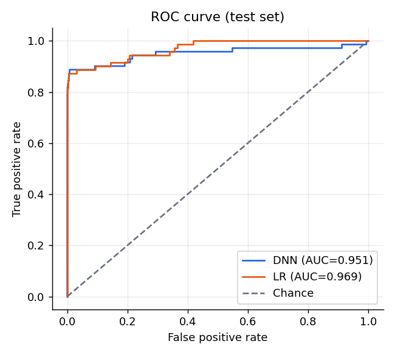
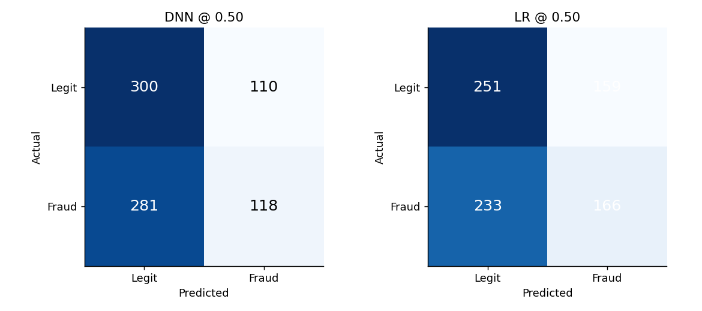
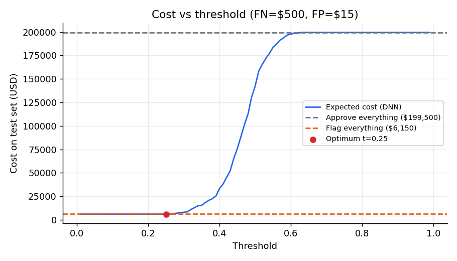
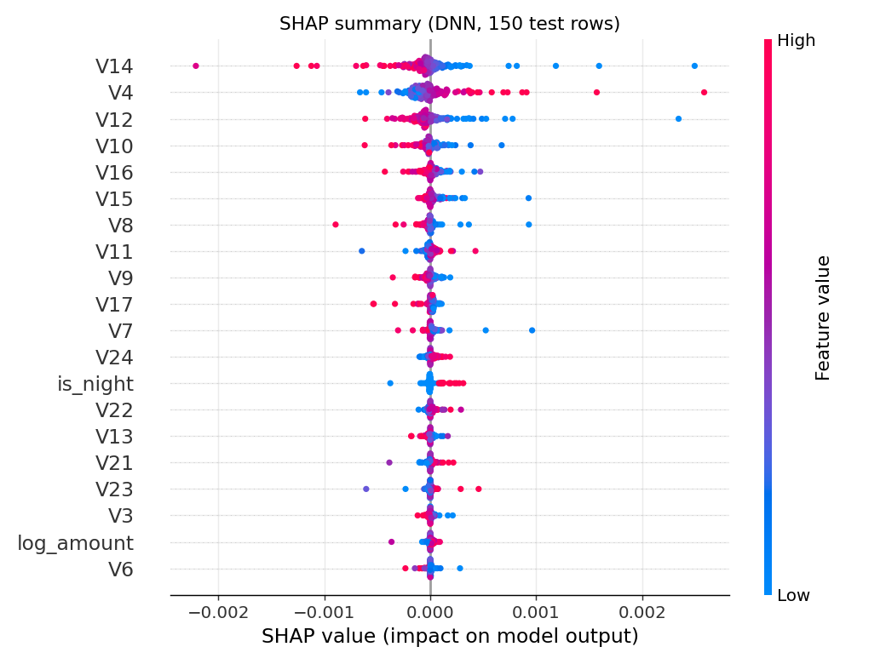

# Task 9 & 10 Report — Intelligent Fraud Detection System

## 1. System integration
`FraudPipeline` (`src/pipeline.py`) integrates validation, feature engineering, two models (Keras DNN, logistic regression), SHAP explanations, a nearest-neighbour trust score, human-in-the-loop routing and report generation. A Streamlit app (`app.py`, `pages/`) exposes it through six pages and only calls `src/`. Dataset: 5,389 transactions, 49.3% fraud; split 70/15/15 stratified (3772/808/809); preprocessor fit on train only.

> **Key finding.** Both models score close to chance (test ROC-AUC 0.524 DNN, 0.510 LR). A 5-fold gradient-boosting check on the raw data gives ≈0.51 as well. The dataset shows no learnable fraud signal (fraud rate is ≈49% in every category, and the account numbers and descriptions are unique per row, which suggests simulated data). The system demonstrates integration, explainability, testing and governance; it does **not** demonstrate real fraud-detection skill.

## 2. Deliverables inventory
| Deliverable | Path |
|---|---|
| Pipeline | `src/pipeline.py` |
| Features / data / training / evaluation | `src/features.py`, `src/data.py`, `src/train.py`, `src/evaluate.py` |
| App | `app.py`, `pages/`, `src/ui.py`, `.streamlit/config.toml` |
| Models | `models/fraud_lr_model.pkl`, `models/fraud_dnn_model.keras`, `models/preprocessor.pkl`, `models/metadata.json` |
| Metrics and CSVs | `reports/metrics.json`, `cost_threshold.csv`, `latency.json`, `shap_stability.json`, `fairness_gender.csv`, `fairness_age.csv`, `robustness.csv`, `drift_baseline.csv`, `deployment_readiness.csv`, `testing_report.csv` |
| Figures | `reports/figures/` |
| Tests | `tests/` |
| Documentation | `docs/SRS.md`, `SDD.md`, `USER_MANUAL.md`, `RESPONSIBLE_AI_REPORT.md`, `DEPLOYMENT_GUIDE.md`, `TESTING_REPORT.md`, `FINAL_REPORT.md` |
| Notebook | `notebooks/01_eda_and_training.ipynb` |
| Deployment | `Dockerfile`, `scripts/run_all.sh` |

## 3. Functional testing
13/13 automated tests pass (valid score, negative amount rejected, missing field rejected, probabilities in [0,1], recommendation in allowed set, non-empty report, batch of 20, batch-vs-single parity, latency). Details: `docs/TESTING_REPORT.md`.

## 4. Performance evaluation
| Metric | DNN (threshold 0.50) | Logistic regression (0.50) |
|---|---|---|
| ROC-AUC | 0.524 | 0.510 |
| PR-AUC | 0.508 | 0.506 |
| F1 | 0.376 | 0.459 |
| Precision | 0.518 | 0.511 |
| Recall | 0.296 | 0.416 |
| Accuracy | 0.517 | 0.515 |
| Flag rate | 28.2% | 40.2% |
| Confusion matrix (TN/FP/FN/TP) | 300/110/281/118 | 251/159/233/166 |

Test set: 809 transactions (49.3% fraud). Source: `reports/metrics.json`.

The operating DNN threshold is **0.50**: the F1-maximising threshold on the validation split *subject to a validation false-positive-rate guardrail of 30%*. Without the guardrail, F1 is maximised at threshold 0.01, which flags 100% of transactions (F1 = 0.66 simply because the base rate is ≈49%), which is the "flag everything" failure seen in an earlier version of this project. The cost-optimal validation threshold is also 0.01 (flag everything costs $6,150 vs $199,500 for approving everything, because a model with no signal cannot beat flagging everything when a missed fraud costs $500 and a false alarm $15). On the test set the cost optimum is 0.25 ($6,120). All three thresholds are recorded in `models/metadata.json`.

Latency: single row 6.7 ms mean / 5.8 ms p95 without SHAP; 105 ms mean / 123 ms p95 with SHAP; batch 14,159 rows/s.

## 5. Explainability
Top-5 SHAP factors per decision; stability 0.997 ± 0.005 Spearman under 1% noise. Most important features: Account_Balance, hour, Customer_Age, Category, month.

## 6. Responsible AI
Fairness gaps (flag rate): gender 0.123, age 0.187 (criterion 0.10; not met, noisy). Robustness: DNN flips in 100% of 15 cases, median distance 1.12 SD. Human review: 267 of 809 test transactions go to MANUAL REVIEW. Full discussion in `docs/RESPONSIBLE_AI_REPORT.md`.

## 7. Deployment readiness
| check                              | criterion                            | measured           | status   |
|:-----------------------------------|:-------------------------------------|:-------------------|:---------|
| DNN predictive power               | test ROC-AUC >= 0.70                 | 0.524              | FAIL     |
| LR predictive power                | test ROC-AUC >= 0.70                 | 0.510              | FAIL     |
| Flag rate sanity                   | DNN flag rate <= 50%                 | 28.2%              | PASS     |
| False-positive rate                | DNN FPR <= 30%                       | 26.8%              | PASS     |
| Expected cost vs flag-all baseline | DNN cost < flag-everything cost      | $142,150 vs $6,150 | FAIL     |
| Single-row latency (no SHAP)       | p95 <= 100 ms                        | 5.8 ms             | PASS     |
| Single-row latency (with SHAP)     | p95 <= 2000 ms                       | 123 ms             | PASS     |
| Batch throughput                   | >= 100 rows/s                        | 14159 rows/s       | PASS     |
| Explanation stability              | mean Spearman >= 0.80                | 0.997 +/- 0.005    | PASS     |
| Fairness (gender)                  | flag-rate gap <= 0.10                | 0.123              | FAIL     |
| Fairness (age band)                | flag-rate gap <= 0.10                | 0.187              | FAIL     |
| Robustness                         | median flip distance >= 0.5 std      | 1.124 std          | PASS     |
| Data drift (train vs test)         | max PSI <= 0.25                      | 0.161              | PASS     |
| Automated tests                    | all pass                             | 13/13 passed       | PASS     |
| Model artifacts & metadata         | all files present, metadata complete | complete           | PASS     |

**5 of 15 checks fail** (predictive power, cost vs flag-all, fairness). The software checks (latency, throughput, stability, drift, tests, artifacts) pass.

## 8. Limitations
No learnable signal in the data; unrealistic ≈49% fraud prevalence (thresholds need recalibration on realistic traffic); likely synthetic data; small fairness groups; train-vs-test drift only; SHAP explains the DNN only.

## 9. Future enhancements
Use real labelled data with realistic prevalence; recalibrate thresholds and probabilities; add temporal validation; richer behavioural features (velocity, device, geography); fairness mitigation; scheduled PSI monitoring job and an analyst feedback loop; authentication and audit logging.
