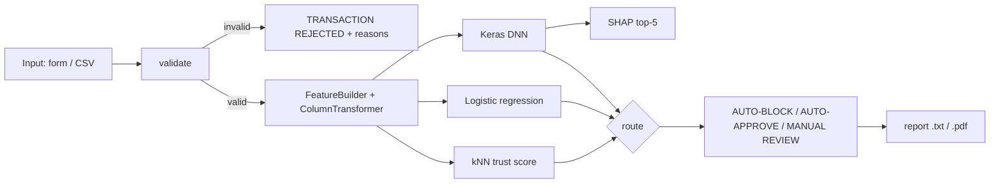

# Software Design Description

## 1. Architecture

## 2. Modules
| Module | Responsibility |
|---|---|
| `src/config.py` | paths, seed 42, costs, schema, ranges, verdict strings |
| `src/data.py` | load/clean, stratified 70/15/15 split (3772/808/809) |
| `src/features.py` | `FeatureBuilder` (hour, day of week, month, weekend, Amount_to_Income, Amount_to_Balance, occupation and merchant frequency) + `ColumnTransformer` (StandardScaler + OneHotEncoder), fit on train only |
| `src/train.py` | LR + DNN (64-32-16, dropout 0.3, L2, early stopping on validation loss), threshold selection, sanity gate |
| `src/pipeline.py` | `FraudPipeline`: validate, score, explain, trust_score, route, generate_report, score_batch |
| `src/evaluate.py` | all metrics, figures, fairness, robustness, drift, latency, SHAP stability, readiness |
| `src/ui.py`, `app.py`, `pages/` | Streamlit UI (cached resources, presets, charts); calls only `src/` |
| `scripts/` | `prepare_data.py`, `run_all.sh`, `build_docs.py`, `build_report_pdf.py`, `screenshots.py` |

## 3. Inference data flow
1. `validate(record)` returns a list of errors (empty when valid).
2. `FeatureBuilder` derives the 36-column model input (after one-hot encoding) with the saved preprocessor.
3. DNN and LR produce probabilities; the DNN is compared with threshold 0.50, LR with 0.50.
4. Trust = (95th percentile of leave-one-out mean 5-NN distances in the training set) ÷ (mean 5-NN distance of the query), capped at 10. Values ≥ 1.0 mean the transaction is as familiar as 95% of training rows.
5. `route` combines agreement and trust. Explanation uses `shap.KernelExplainer` on the 16 engineered features (12 numeric, 4 categorical; categories decoded before the preprocessor) with a 100-row background sample built once.

## 4. Thresholds
The operating DNN threshold is **0.50**: the F1-maximising threshold on the validation split *subject to a validation false-positive-rate guardrail of 30%*. Without the guardrail, F1 is maximised at threshold 0.01, which flags 100% of transactions (F1 = 0.66 simply because the base rate is ≈49%), which is the "flag everything" failure seen in an earlier version of this project. The cost-optimal validation threshold is also 0.01 (flag everything costs $6,150 vs $199,500 for approving everything, because a model with no signal cannot beat flagging everything when a missed fraud costs $500 and a false alarm $15). On the test set the cost optimum is 0.25 ($6,120). All three thresholds are recorded in `models/metadata.json`.

## 5. Persistence
| Artifact | File |
|---|---|
| Preprocessor (FeatureBuilder + ColumnTransformer) | `models/preprocessor.pkl` |
| Logistic regression | `models/fraud_lr_model.pkl` |
| DNN | `models/fraud_dnn_model.keras` |
| Feature list, thresholds, library versions, training date (2026-10-12), dataset rows (5,389) | `models/metadata.json` |
| Splits and cleaned data | `data/processed/` |
| Evaluation outputs | `reports/` |

The model and preprocessor must always be deployed as a matched pair.
