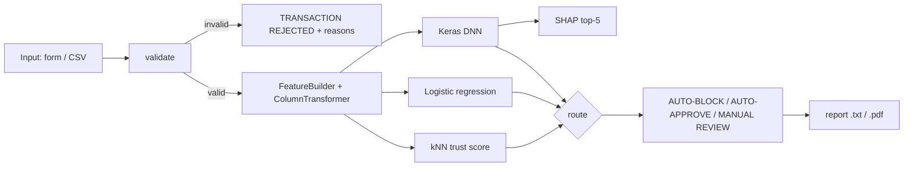

# Software Design Description

## 1. Architecture

## 2. Modules
| Module | Responsibility |
|---|---|
| `src/config.py` | paths, seed 42, costs, schema (Time, V1-V28, Amount), ranges, trust reference size, verdict strings |
| `src/data.py` | load/clean (drop duplicates), stratified 70/15/15 split (198608/42559/42559) |
| `src/features.py` | `FeatureBuilder` (hour of day and a night flag derived from `Time`, `log_amount`; raw `Time` is dropped because "seconds since the dataset started" has no meaning for new transactions) + `ColumnTransformer` (StandardScaler), fit on train only |
| `src/train.py` | LR + DNN (64-32-16, dropout 0.3, L2, batch 512, early stopping on validation loss; class imbalance handled by threshold choice rather than class weights), threshold selection, sanity gate |
| `src/pipeline.py` | `FraudPipeline`: validate, score, explain, trust_score, route, generate_report, score_batch |
| `src/evaluate.py` | all metrics, figures, subgroup analysis, robustness, drift, latency, SHAP stability, readiness |
| `src/ui.py`, `app.py`, `pages/` | Streamlit UI (cached resources, presets, charts); calls only `src/` |
| `scripts/` | `prepare_data.py`, `run_all.sh`, `build_docs.py`, `build_report_pdf.py`, `screenshots.py` |

## 3. Inference data flow
1. `validate(record)` returns a list of errors (empty when valid).
2. `FeatureBuilder` derives the 32-column model input (after one-hot encoding) with the saved preprocessor.
3. DNN and LR produce probabilities; the DNN is compared with threshold 0.40, LR with 0.50.
4. Trust = (95th percentile of leave-one-out mean 5-NN distances in the reference set) ÷ (mean 5-NN distance of the query), capped at 10. The reference set holds every training fraud plus a fixed sample of 20,000 legitimate training rows (keeps the index small enough to load in seconds). Values ≥ 1.0 mean the transaction is as familiar as 95% of reference rows.
5. `route` combines agreement and trust. Explanation uses `shap.KernelExplainer` on the 32 engineered features (V1-V28, Amount, hour, night flag, log amount) with a 100-row background sample built once.

## 4. Thresholds
The operating DNN threshold is **0.40**: the F1-maximising threshold on the validation split, subject to a validation false-positive-rate guardrail of 30% (the guardrail is not binding here; the unconstrained F1 optimum is also 0.40). With a missed fraud costing $500 and a false alarm $15, the cost-optimal validation threshold is lower, **0.04**. On the test set it catches 58 frauds with 34 false alarms (cost $7,010), against 56 frauds and 13 false alarms (cost $7,695) at 0.40. Baselines: approving everything costs $35,500; flagging everything $637,320. The F1 threshold is kept as the operating point because it keeps the alert volume lowest; a bank that prices misses at $500 should consider switching to 0.04. All thresholds are recorded in `models/metadata.json`.

## 5. Persistence
| Artifact | File |
|---|---|
| Preprocessor (FeatureBuilder + ColumnTransformer) | `models/preprocessor.pkl` |
| Logistic regression | `models/fraud_lr_model.pkl` |
| DNN | `models/fraud_dnn_model.keras` |
| Feature list, thresholds, library versions, training date (2026-10-25), dataset rows (283,726) | `models/metadata.json` |
| Splits and cleaned data | `data/processed/` |
| Evaluation outputs | `reports/` |

The model and preprocessor must always be deployed as a matched pair.
