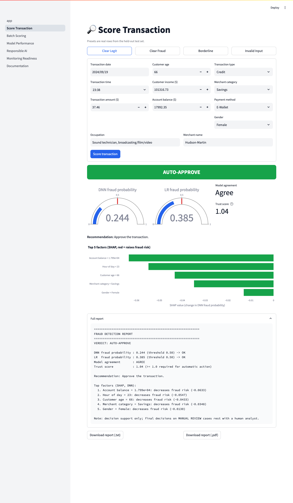
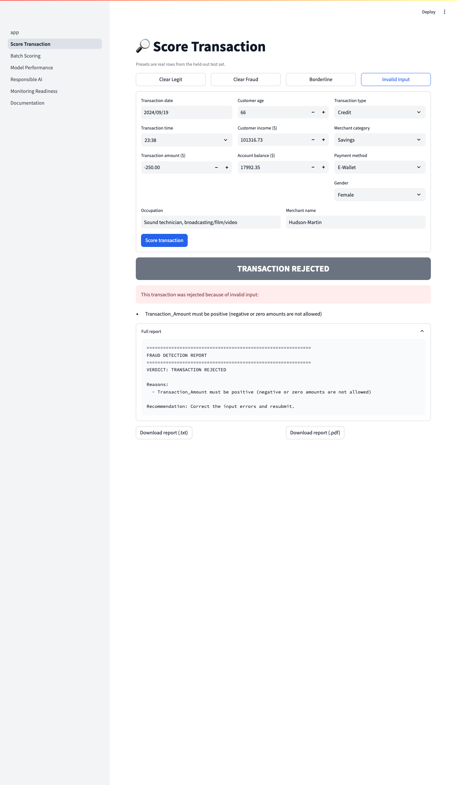

# User Manual

Start the app: `streamlit run app.py` (see DEPLOYMENT_GUIDE). Use the sidebar to switch pages.

## Home
Project overview, dataset summary, architecture and headline test metrics.

## Scoring a single transaction
1. Open **Score Transaction**.
2. Either click a preset (**Clear Legit**, **Clear Fraud**, **Borderline**, **Invalid Input**; all built from real held-out test rows) or fill in the form.
3. Click **Score transaction**.
4. Read the coloured verdict (red AUTO-BLOCK, green AUTO-APPROVE, amber MANUAL REVIEW, grey TRANSACTION REJECTED), the DNN and LR probability gauges (red line = threshold), model agreement, trust score and the top-5 SHAP factors (red raises fraud risk, green lowers it).
5. Download the report as **.txt** or **.pdf**.

## Batch scoring
1. Open **Batch Scoring** and download the CSV template (or the 20-row sample, which includes two deliberately invalid rows).
2. Upload a CSV containing every required column.
3. Optionally tick *Include SHAP top-5 factors* (slower).
4. Watch the progress bar, inspect the results table and verdict chart, then download the results CSV. Invalid rows show their reasons in the `errors` column.

## Other pages
**Model Performance** (metrics, ROC/PR, interactive threshold slider, latency), **Responsible AI** (fairness, robustness, SHAP), **Monitoring & Readiness** (PSI drift, readiness checklist, retraining/rollback), **Documentation** (these documents).

## Troubleshooting
"Models or reports are missing": run `bash scripts/run_all.sh`. "File is missing required columns": use the CSV template.
