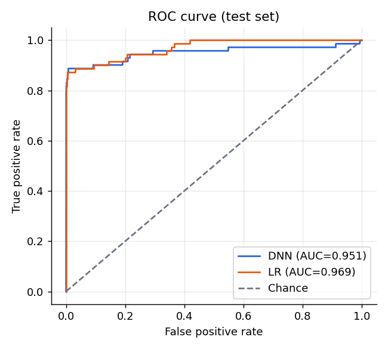
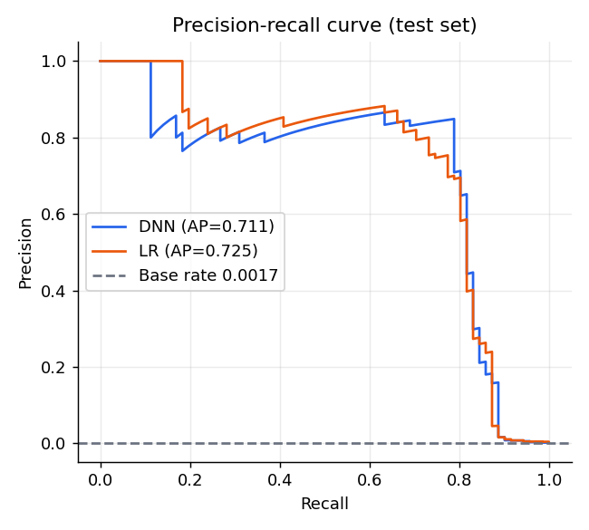
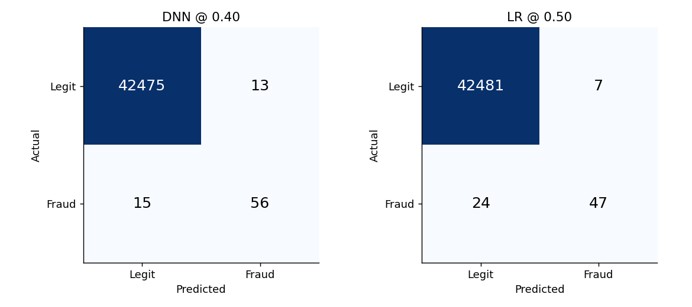
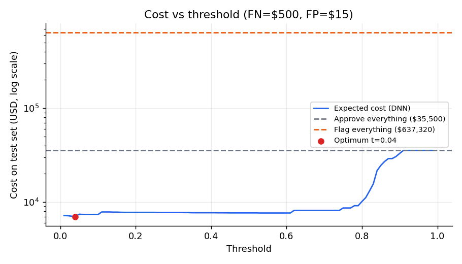
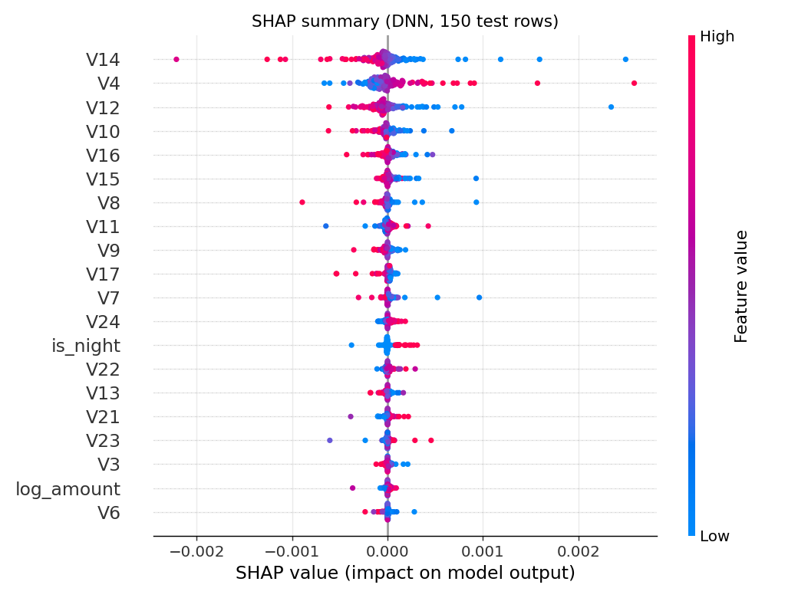

# Task 9 & 10 Report — Intelligent Fraud Detection System

## 1. System integration
`FraudPipeline` (`src/pipeline.py`) integrates validation, feature engineering, two models (Keras DNN, logistic regression), SHAP explanations, a nearest-neighbour trust score, human-in-the-loop routing and report generation. A Streamlit app (`app.py`, `pages/`) exposes it through six pages and only calls `src/`. Dataset: 283,726 credit-card transactions, 473 frauds (0.167%); split 70/15/15 stratified (198608/42559/42559); preprocessor fit on train only.

> **Key finding.** Both models detect fraud well in ranking terms: test ROC-AUC 0.951 (DNN) and 0.969 (LR), PR-AUC 0.711 and 0.725 against a fraud base rate of only 0.17%. At its operating threshold the DNN catches 56 of 71 test frauds with 13 false alarms among 42,488 legitimate transactions. The simple logistic regression ranks slightly better than the DNN; the DNN's advantage is higher recall at the chosen threshold. Caveats: only 71 frauds in the test set (wide uncertainty), anonymised PCA features (explanations are not business-readable), two days of 2013 data, a random rather than temporal split, and no customer attributes for a fairness audit.

## 2. Deliverables inventory
| Deliverable | Path |
|---|---|
| Pipeline | `src/pipeline.py` |
| Features / data / training / evaluation | `src/features.py`, `src/data.py`, `src/train.py`, `src/evaluate.py` |
| App | `app.py`, `pages/`, `src/ui.py`, `.streamlit/config.toml` |
| Models | `models/fraud_lr_model.pkl`, `models/fraud_dnn_model.keras`, `models/preprocessor.pkl`, `models/metadata.json` |
| Metrics and CSVs | `reports/metrics.json`, `cost_threshold.csv`, `latency.json`, `shap_stability.json`, `fairness_amount.csv`, `fairness_time.csv`, `robustness.csv`, `drift_baseline.csv`, `deployment_readiness.csv`, `testing_report.csv` |
| Figures | `reports/figures/` |
| Tests | `tests/` |
| Documentation | `docs/SRS.md`, `SDD.md`, `USER_MANUAL.md`, `RESPONSIBLE_AI_REPORT.md`, `DEPLOYMENT_GUIDE.md`, `TESTING_REPORT.md`, `FINAL_REPORT.md` |
| Notebook | `notebooks/01_eda_and_training.ipynb` |
| Deployment | `Dockerfile`, `scripts/run_all.sh` |

## 3. Functional testing
13/13 automated tests pass (valid score, negative amount rejected, missing field rejected, probabilities in [0,1], recommendation in allowed set, non-empty report, batch of 20, batch-vs-single parity, latency). Details: `docs/TESTING_REPORT.md`.

## 4. Performance evaluation
| Metric | DNN (threshold 0.40) | Logistic regression (0.50) |
|---|---|---|
| ROC-AUC | 0.951 | 0.969 |
| PR-AUC | 0.711 | 0.725 |
| F1 | 0.800 | 0.752 |
| Precision | 0.812 | 0.870 |
| Recall | 0.789 | 0.662 |
| Accuracy | 0.999 | 0.999 |
| Flag rate | 0.16% | 0.13% |
| Confusion matrix (TN/FP/FN/TP) | 42475/13/15/56 | 42481/7/24/47 |

Test set: 42,559 transactions (0.17% fraud, 71 frauds). Source: `reports/metrics.json`.

The operating DNN threshold is **0.40**: the F1-maximising threshold on the validation split, subject to a validation false-positive-rate guardrail of 30% (the guardrail is not binding here; the unconstrained F1 optimum is also 0.40). With a missed fraud costing $500 and a false alarm $15, the cost-optimal validation threshold is lower, **0.04**. On the test set it catches 58 frauds with 34 false alarms (cost $7,010), against 56 frauds and 13 false alarms (cost $7,695) at 0.40. Baselines: approving everything costs $35,500; flagging everything $637,320. The F1 threshold is kept as the operating point because it keeps the alert volume lowest; a bank that prices misses at $500 should consider switching to 0.04. All thresholds are recorded in `models/metadata.json`.

Latency: single row 7.3 ms mean / 10.0 ms p95 without SHAP; 430 ms mean / 545 ms p95 with SHAP; batch 4,197 rows/s.

## 5. Explainability
Top-5 SHAP factors per decision; stability 0.995 ± 0.019 Spearman under 1% noise. Most important features: V14, V4, V12, V10, V16.

## 6. Responsible AI
No customer attributes exist, so subgroup performance is measured by amount band and time of day: recall gaps 0.311 and 0.265 (criterion 0.20; not met, based on 7-34 frauds per segment). Robustness: no DNN class flips within 3 SD of random perturbation (15/15 cases). Human review: 1,895 of 42,559 test transactions (4.5%) go to MANUAL REVIEW; of the 71 test frauds 14 are auto-blocked, 45 reviewed and 12 missed. Full discussion in `docs/RESPONSIBLE_AI_REPORT.md`.

## 7. Deployment readiness
| check                              | criterion                            | measured                           | status   |
|:-----------------------------------|:-------------------------------------|:-----------------------------------|:---------|
| DNN predictive power               | test ROC-AUC >= 0.70                 | 0.951                              | PASS     |
| LR predictive power                | test ROC-AUC >= 0.70                 | 0.969                              | PASS     |
| DNN precision-recall (rare class)  | test PR-AUC >= 0.50                  | 0.711                              | PASS     |
| Flag rate sanity                   | DNN flag rate <= 50%                 | 0.2%                               | PASS     |
| False-positive rate                | DNN FPR <= 30%                       | 0.0%                               | PASS     |
| Expected cost vs flag-all baseline | DNN cost < flag-everything cost      | $7,695 vs $637,320                 | PASS     |
| Single-row latency (no SHAP)       | p95 <= 100 ms                        | 10.0 ms                            | PASS     |
| Single-row latency (with SHAP)     | p95 <= 2000 ms                       | 545 ms                             | PASS     |
| Batch throughput                   | >= 100 rows/s                        | 4197 rows/s                        | PASS     |
| Explanation stability              | mean Spearman >= 0.80                | 0.995 +/- 0.019                    | PASS     |
| Subgroup recall (amount band)      | recall gap <= 0.20                   | 0.311                              | FAIL     |
| Subgroup recall (time of day)      | recall gap <= 0.20                   | 0.265                              | FAIL     |
| Robustness                         | median flip distance >= 0.5 std      | >= 3.000 std (15/15 never flipped) | PASS     |
| Data drift (train vs test)         | max PSI <= 0.25                      | 0.001                              | PASS     |
| Automated tests                    | all pass                             | 13/13 passed                       | PASS     |
| Model artifacts & metadata         | all files present, metadata complete | complete                           | PASS     |

**2 of 16 checks fail** (Subgroup recall (amount band), Subgroup recall (time of day)). Predictive power, cost, latency, throughput, stability, robustness, drift, tests and artifacts pass.

## 8. Limitations
Few positives (71 test frauds); anonymised PCA features (explanations not business-readable); two days of 2013 data and a random split (optimistic metrics, no real drift estimate); no customer attributes for fairness; SHAP explains the DNN only.

## 9. Future enhancements
Temporal validation (train on day 1, test on day 2) and re-validation on recent traffic; probability calibration; amount-weighted cost (a missed $2,000 fraud costs more than a missed $2 one); gradient-boosting comparison; richer behavioural features (velocity, device, merchant) if non-anonymised data is available; a fairness audit with customer attributes; scheduled PSI monitoring job and an analyst feedback loop; authentication and audit logging.
